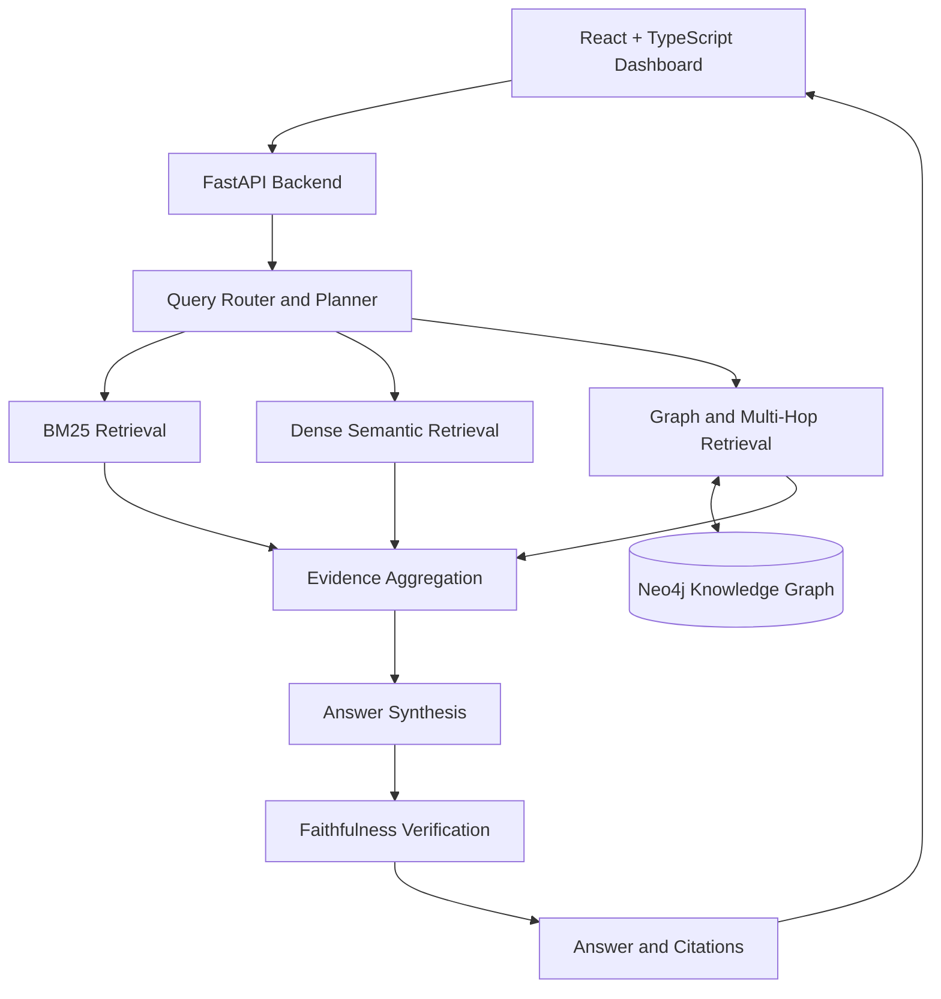

# Graphitti — Graph-Native Web Intelligence

Graphitti is a graph-native web intelligence platform that combines knowledge graphs, lexical retrieval, dense semantic search, and multi-hop reasoning to answer questions with traceable evidence.

It connects entities and relationships extracted from web documentation, retrieves relevant supporting evidence, and verifies answers before returning them through a FastAPI backend and a React dashboard.

## Key Features

- **Knowledge Graph:** Stores entities, claims, and semantic relationships in Neo4j.
- **Hybrid Retrieval:** Supports BM25 keyword search, dense semantic retrieval, graph retrieval, and Reciprocal Rank Fusion (RRF).
- **Multi-Hop Reasoning:** Traverses multiple relationships to answer connected questions.
- **Evidence-Based Answers:** Returns source citations and structured relationship metadata.
- **Faithfulness Verification:** Checks relational answers against retrieved graph claims.
- **Interactive Dashboard:** Displays graph data, query results, source evidence, and retrieval benchmarks.
- **Evaluation Toolkit:** Includes retrieval benchmarks, relation-evaluation scripts, and graph-coverage audits.

## Architecture



## Technology Stack

| Layer | Technologies |
|---|---|
| Frontend | React, TypeScript, Vite, CSS |
| Backend | Python, FastAPI |
| Knowledge Graph | Neo4j, Cypher |
| Retrieval | BM25, dense embeddings, graph retrieval, RRF |
| NLP and Extraction | Entity detection, entity linking, claim extraction, relation extraction |
| Evaluation | Retrieval metrics, relation metrics, multi-hop tests |
| Infrastructure | Docker, Git, GitHub |

## Example Queries

**Direct relationship**

> What dependencies does FastAPI have?

Expected answer:

FastAPI depends on Pydantic and Starlette.

**Relationship lookup**

> What does FastAPI use?

Expected answer:

FastAPI uses Uvicorn.

**Multi-hop reasoning**

> What does FastAPI depend on that also uses HTTPX?

Expected answer:

FastAPI depends on Starlette. Starlette uses HTTPX.

The application returns source evidence to support its answers.

## Local Development Setup

### Prerequisites

- Python 3.13 (the version used in the current local development environment)
- Node.js and npm
- Docker Desktop
- Git

### 1. Clone the repository

```powershell
git clone https://github.com/kalyaniburadk20/Graphitti.git
cd Graphitti
```

### 2. Configure Python

Run these commands from the project root:

```powershell
python -m venv .venv
.\.venv\Scripts\Activate.ps1
python -m pip install --upgrade pip
pip install -r requirements.txt
```

### 3. Start Neo4j

For a fresh local setup, run:

```powershell
docker run -d --name graphitti-neo4j -p 7474:7474 -p 7687:7687 -e NEO4J_AUTH=neo4j/change_me_please -v graphitti_neo4j_data:/data neo4j:latest
```

If you already have a container named `graphitti-neo4j`, start that container instead of creating another one:

```powershell
docker start graphitti-neo4j
```

### 4. Configure environment variables

Create a `.env` file in the project root:

```env
NEO4J_URI=bolt://localhost:7687
NEO4J_USERNAME=neo4j
NEO4J_PASSWORD=change_me_please
NEO4J_DATABASE=neo4j
```

Use a private password of your own. The password above is only an example for a fresh local container.

**Never commit `.env` or real credentials to GitHub.**

### 5. Prepare graph data

Graph ingestion uses local processed data artifacts. These artifacts are intentionally excluded from the repository.

Populate the required local processed data before running:

```powershell
python backend\sync_graph.py
```

A fresh clone does not include the full local crawl and processed corpus, so graph ingestion may require preparing that data first.

### 6. Start the backend

From the project root, with the Python environment activated:

```powershell
python -m uvicorn app.main:app --app-dir .\backend --reload --host 127.0.0.1 --port 8000
```

Backend URLs:

- API: `http://127.0.0.1:8000`
- Interactive API documentation: `http://127.0.0.1:8000/docs`
- Health check: `http://127.0.0.1:8000/health`

### 7. Start the frontend

Open a second terminal at the project root:

```powershell
npm --prefix .\frontend install
npm --prefix .\frontend run dev
```

Open `http://localhost:5173/` in your browser.

Keep the backend, Neo4j, and frontend running while testing the dashboard.

## API Endpoints

| Method | Endpoint | Purpose |
|---|---|---|
| GET | `/` | Backend welcome endpoint |
| GET | `/health` | Health check |
| GET | `/graph` | Graph snapshot and counts |
| GET | `/benchmark` | Saved retrieval benchmark metrics |
| POST | `/query` | Query the intelligence pipeline |
| POST | `/crawl` | Trigger the crawler workflow |

Example request body for `POST /query`:

```json
{
  "query": "What does FastAPI depend on that also uses HTTPX?"
}
```

## Benchmark Results

The committed benchmark snapshot contains results from a small local evaluation set.

| Strategy | Recall@1 | Recall@3 | Recall@5 | MRR | Avg. latency |
|---|---:|---:|---:|---:|---:|
| BM25 | 61.11% | 77.78% | 94.44% | 0.7213 | 0.26 ms |
| Dense | 44.44% | 55.56% | 72.22% | 0.5296 | 14.56 ms |
| Graph | 33.33% | 33.33% | 33.33% | 0.3333 | 22.36 ms |
| Hybrid RRF | 50.00% | 83.33% | 88.89% | 0.6528 | 29.51 ms |

### Multi-Hop Evaluation

| Metric | Result |
|---|---:|
| Evaluated queries | 2 |
| Path accuracy | 100% |
| Average latency | 8.11 ms |

These are saved local benchmark results, not a guarantee of general performance. The evaluation sets are small, and measured latency depends on the machine, model loading, and execution environment.

## Testing

From the project root, with the backend dependencies installed and Neo4j available, useful validation commands include:

```powershell
python .\backend\test_graph_retrieval.py
python .\backend\test_multi_hop.py
python .\backend\test_orchestrator.py
```

Build the frontend for production:

```powershell
npm --prefix .\frontend run build
```

The direct dependency query, general relationship query, multi-hop API flow, orchestrator scenarios, and frontend production build have been validated in the current development environment.

## Project Structure

```text
Graphitti/
├── backend/
│   ├── app/
│   │   ├── agents/
│   │   ├── crawler/
│   │   ├── evaluation/
│   │   ├── extraction/
│   │   ├── graph/
│   │   ├── nlp/
│   │   ├── retrieval/
│   │   └── routing/
│   ├── sync_graph.py
│   ├── run_benchmark.py
│   └── test_*.py
├── data/
│   ├── benchmark/
│   └── evaluation/
├── frontend/
│   └── src/
├── .gitignore
└── requirements.txt
```

## Current Scope and Limitations

- The graph and benchmark data in the current development environment are local snapshots.
- Raw crawled data and processed graph-ingestion artifacts are not committed.
- The committed benchmark sample is too small to establish general retrieval performance.
- Production deployment, authentication, and large-scale evaluation require additional work.

## Repository

GitHub: https://github.com/kalyaniburadk20/Graphitti
